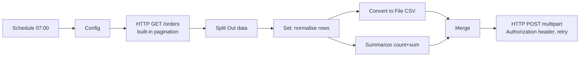
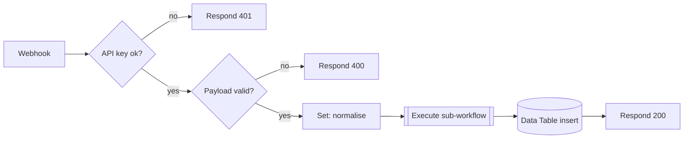
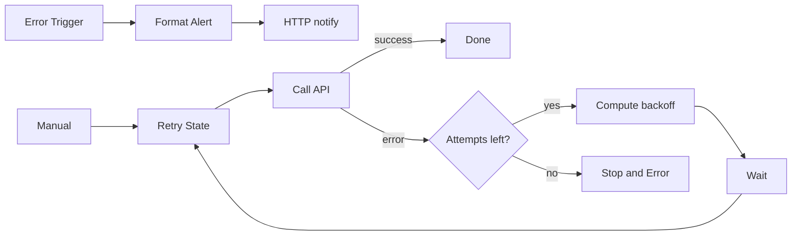
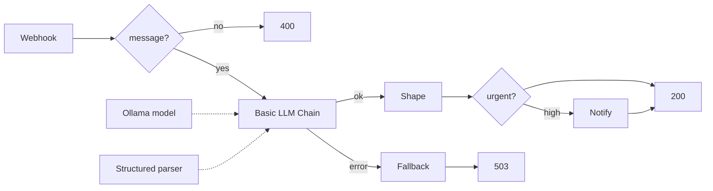

# n8n Automation Showcase

Five importable n8n workflows (plus one helper sub-workflow) built with **n8n core nodes only**, and a static, dependency-free viewer that draws each workflow as an SVG node graph from its exported JSON.

Built by Saad Ali Khan while working through the n8n Academy courses: *Quickstart*, *Essentials: Your First Workflows*, *Integrations: APIs & Connected Workflows* and *In Practice: AI Testing & Best Practices*.

No credentials, real URLs or secrets are included. Endpoints are placeholders (`api.example.com`) and secrets are read from environment variables.

## Contents

```
workflows/   six importable n8n JSON exports
docs/        static viewer (index.html, viewer.js, viewer.css, generated workflows-data.js, workflows/*.json for download)
scripts/     validate.mjs, build-data.mjs, build-demo.mjs, serve.mjs, docker-import-check.sh, check-node-versions.sh
.github/     CI: runs validate.mjs and the demo build
```

## Viewer demo

```bash
npm run build:demo      # regenerates docs/workflows-data.js and copies docs/ -> dist-demo/
npm run serve           # optional local preview on :8080 (or just open docs/index.html via file://)
```

`dist-demo/` is plain static files with relative URLs only, so it can be hosted under any sub-path (for example `/demos/n8n-workflows/`). It loads no scripts, fonts or images from the network and works under the CSP
`default-src 'self'; img-src 'self' data:; style-src 'self' 'unsafe-inline'; script-src 'self'` (the page also sets this as a `<meta>` CSP). The viewer only draws JSON; it does not run workflows.

## The workflows

### 1. `api-pagination-to-csv-report.json`
Daily 07:00 report: page through a REST API, flatten, normalise, build CSV + totals, merge, upload with a bearer header.



### 2. `authenticated-webhook-intake.json` (+ `sub-workflow-enrich-submission.json`)
`POST /webhook/intake` with header `x-api-key`. Wrong key -> **401**, invalid body -> **400**, otherwise normalise -> sub-workflow (priority + ticket ref) -> Data Table insert -> **200**.



### 3. `error-alert-workflow.json`
(A) Error Trigger -> format message -> Slack-shaped webhook notification. (B) Retry loop with exponential backoff + jitter that ends in Stop and Error (which fires the alert).



### 4. `ai-feedback-classifier.json`
`POST /webhook/feedback {"message": "..."}`. A Basic LLM Chain (local Ollama) with a Structured Output Parser returns `sentiment`, `category`, `urgency`, `summary` (enums enforced by JSON schema). High urgency -> HTTP notification. If the chain fails, its error output returns 503 with `needs_human_review: true`.



### 5. `ai-agent-with-tools.json`
Chat Trigger -> AI Agent with Ollama chat model, Window Buffer Memory (8 turns), an HTTP Request tool (exchange rates, placeholder API) and a Calculator tool.

```
Chat Trigger --> AI Agent <-.. Ollama Chat Model
                    ^  ^  ^
   memory ----------'  |  '---- tools: HTTP Request, Calculator
```

## Importing

1. In n8n: *Workflows -> Import from file*, or CLI: `n8n import:workflow --input=workflows/<file>.json`.
2. Import `sub-workflow-enrich-submission.json` first, then open **Enrich (sub-workflow)** in the intake workflow and select it (the ID is a `REPLACE_WITH_SUBWORKFLOW_ID` placeholder).
3. Create a Data Table with columns `name, email, message, priority, ticketRef` (strings) and select it in **Store in Data Table** (`REPLACE_WITH_DATA_TABLE_ID`).
4. For the two AI workflows, create an **Ollama** credential and pick it on the *Ollama Chat Model* node. The exports reference a placeholder credential (`id: REPLACE_ME`).
5. Set the environment variables below. Workflows are exported inactive.

### Environment / placeholders

See `.env.example`. n8n 2.x blocks `$env` inside expressions by default, so start n8n with `N8N_BLOCK_ENV_ACCESS_IN_NODE=false` (or replace the expressions with credentials/variables you prefer).

| Variable | Used by |
|---|---|
| `REPORT_API_BASE_URL`, `REPORT_API_TOKEN`, `REPORT_DELIVERY_URL` | api-pagination-to-csv-report |
| `INTAKE_API_KEY` | authenticated-webhook-intake |
| `ALERT_WEBHOOK_URL`, `FLAKY_API_URL` | error-alert-workflow; `ALERT_WEBHOOK_URL` also ai-feedback-classifier |

The API key check is written as an IF node comparing a header with an env value so no credential object is needed for import. For production you would normally use the Webhook node's built-in Header Auth credential, and a constant-time comparison would be preferable.

### Local Ollama setup

```bash
ollama pull llama3.1:8b     # feedback classifier
ollama pull qwen2.5:7b      # agent (needs a tool-calling model)
```
Ollama credential base URL: `http://localhost:11434` if n8n runs on the host, or `http://host.docker.internal:11434` if n8n runs in Docker (and Ollama listens on a reachable interface, e.g. `OLLAMA_HOST=0.0.0.0`). The base URL lives in the n8n credential, not in the workflow JSON. Small local models can ignore schemas or tools; that is why the classifier has an error branch.

## Patterns demonstrated

| Certificate topic | Where |
|---|---|
| Triggers (schedule, webhook, error, chat, manual, sub-workflow) | all workflows |
| Data transformation (Set, Split Out, Summarize, Convert to File, Code) | 1, 2, sub-workflow |
| Branching (IF, validation, status-code routing) | 2, 3, 4 |
| Pagination | 1 |
| Webhooks + auth, Respond to Webhook with 200/400/401/503 | 2, 4 |
| Sub-workflows (Execute Workflow + Execute Workflow Trigger) | 2 |
| Error workflows, error output branches, Stop and Error | 3, 4 |
| Retries (node-level Retry On Fail, explicit backoff loop with Wait) | 1, 3, 4 |
| AI agents with tools and memory | 5 |
| Structured output parsing, local LLM, LLM error handling | 4 |

## Checks

```bash
npm run validate         # static checks, no dependencies (also run in CI)
npm run check:import     # Docker: imports each workflow into a throwaway n8n container
npm run check:versions   # Docker: verifies node types/typeVersions exist in the n8n image
```

`validate.mjs` checks: valid JSON; required workflow/node fields; unique node names and ids; core node types only; placeholder credential ids; all connection sources/targets exist; no unconnected nodes (triggers, AI sub-nodes, sticky notes excepted); a trigger exists; response-node webhooks have a Respond node; no secret-looking strings; viewer metadata present; `docs/workflows-data.js` is in sync with `workflows/`.

## Honest limits

- **Import was verified, execution was not.** All six files import into n8n 2.45.7 (`n8nio/n8n:latest` as pulled on 2026-10-30) via `n8n import:workflow`, and every node type/version exists in that image's catalogue. Import does not validate every node parameter, and **no workflow was executed or tested end to end**: no live API, Ollama model, Data Table or Slack endpoint was involved. Expect to adjust parameters for your own APIs.
- URLs are placeholders (`api.example.com`); the pagination parameters and response shape (`{ "data": [...] }`, `page`/`limit`) are assumptions to adapt.
- Pagination completion (`data.length < 100`) is hard-coded to the page size of 100.
- The retry loop's use of `$('Retry State')` and error-output item shape were written from documentation and not exercised.
- The viewer renders stored node positions; it is not a full n8n canvas and ignores parameters beyond showing them.
- Not affiliated with n8n. Workflows are exported inactive.
